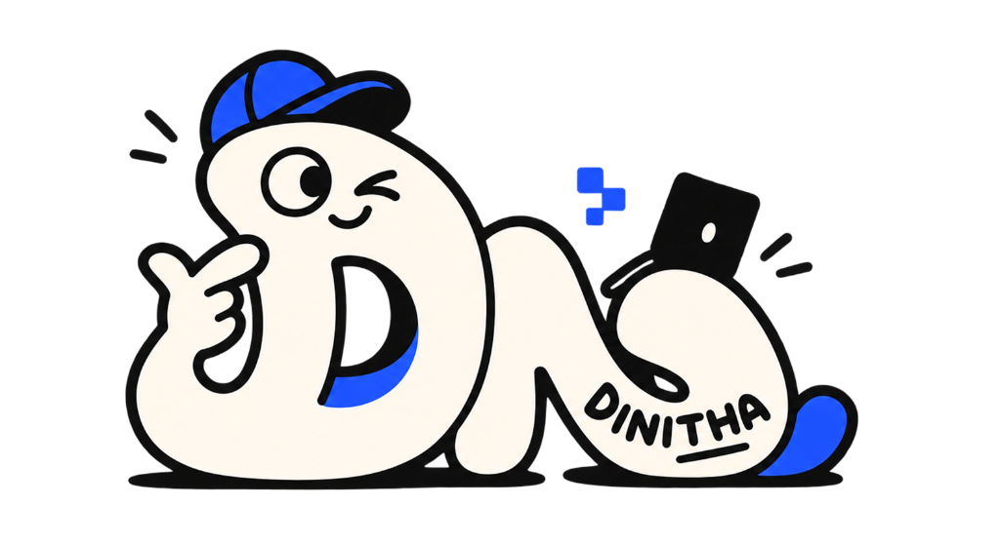
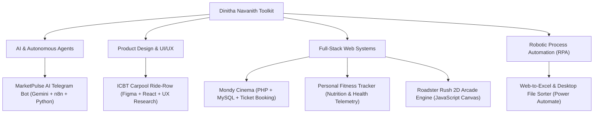

# Dinitha Navanith — Next-Level Portfolio Redesign & Architecture Blueprint



> **"From pixels to products. From design to intelligence."**  
> *Transforming Dinitha Navanith's portfolio from a standard resume site into a high-impact, tier-1 interactive digital experience.*

---

## 1. Executive Summary & Transformation Matrix

Your original PDF wireframes established a solid foundation: clear messaging, dual design & development focus, and well-structured sections. However, in today's competitive product design and engineering market, leading portfolios (such as [Meghan Logan's portfolio](https://www.meghanlogan.com/) and the motion/shader riffs by Hardik Gondhiya & Hijrat on Figma) capture attention through **depth, tactile micro-interactions, distinct brand character, and technical proof-of-work**.

### Before vs. Next-Level Comparison

| Dimension | Previous PDF Design | Next-Level Redesign | Reference Influence |
| :--- | :--- | :--- | :--- |
| **Color & Theme** | Generic light grey / white background | Deep Obsidian (`#08090d`) with electric royal blue & luminous cyan glows | Figma Riffs (Hardik Gondhiya) & Dark tech aesthetic |
| **Brand Identity** | Standard textual header | **Custom Mascot Integration** with floating micro-badges & responsive animations | Dinitha's custom illustrated mascot character |
| **Navigation** | Standard static navigation bar | **Floating Glassmorphic Pill Nav** with blur backdrops, status pulse, and active scrollspy | [Meghan Logan](https://www.meghanlogan.com/) & Modern iOS/macOS |
| **Project Showcase** | Basic static list cards with generic tags | **Interactive Bento Grid** with live category filter tabs, code telemetry, and 3D tilt | Figma Riffs & Modern developer portfolios |
| **Projects Featured** | 4 older academic projects | **6 Diversified Showcases** including latest cutting-edge AI Telegram bot & RPA automations | `github.com/d-navanith` latest updates |
| **Interactivity** | Static text | Interactive 3D mouse parallax cards, real-time filters, live stats ticker | Modern front-end micro-interactions |

---

## 2. Incorporating Your Inspirations

### A. Influence from [Meghan Logan](https://www.meghanlogan.com/)
- **Luminous Pill Navigation**: Centered, floating glass pill featuring subtle gradient borders, backdrop blur (`backdrop-filter: blur(18px)`), and a live "Available for Work" pulsing indicator.
- **Micro-Accents & Sparkles**: Geometric four-pointed sparkles (`✦`), subtle tech pill badges, and refined typographic contrast.
- **Bento Hierarchy**: Thoughtfully paired cards (Philosophy + Undergrad Journey + Design Pillar + Engineering Pillar) giving visitors multiple bite-sized entry points to your story.

### B. Influence from Figma Riffs (Hardik Gondhiya & Hijrat)
- **Fluid Micro-Interactions**: Dynamic 3D card tilt where cards react to your cursor position in real-time with smooth perspective rotation.
- **High-Contrast Dark Canvas**: Deep obsidian layers with subtle grid lines (`48px x 48px`) and atmospheric background radial orbs that create a futuristic studio feel.
- **Live Metrics Marquee**: A continuous running ticker strip showcasing your GitHub volume, years of experience, and multi-disciplinary competencies.

### C. Leveraging Your Custom Mascot
Your illustrated character wearing the royal blue cap with the laptop and floating pixels is a **huge competitive differentiator**. In the redesign, it is deployed purposefully:
1. **Brand Icon**: Scaled and badged inside the floating navigation bar.
2. **Hero Focal Point**: Elevated onto a luminous 3D stage with orbiting tech chips (`UI/UX & Systems`, `Full-Stack & Code`, `AI & Automation`, `2+ YOE`).
3. **Contact Terminal**: Welcoming users at the quick message composer and footer signature.

---

## 3. Updated Project Roster (GitHub + Design Synthesis)

Your portfolio now spotlights your full engineering & design breadth:



### Detailed Project Breakdown:

1. **[MarketPulse AI Telegram Bot](https://github.com/d-navanith/marketpulse-ai-telegram-bot)**
   - *Category*: `Autonomous AI Agent`
   - *Stack*: Python, Google Gemini API, n8n, Telegram Bot API
   - *Highlights*: Cron-scheduled market intelligence pipeline providing autonomous daily financial summaries and sentiment tracking.

2. **[ICBT Carpool Ride-Row](https://github.com/d-navanith/icbt-carpool-ride-row)**
   - *Category*: `UI/UX & Web App`
   - *Stack*: Figma, React, Node.js, Express, MySQL
   - *Highlights*: End-to-end everyday campus ride-sharing experience designed to eliminate commute bottlenecks with seat reservations and driver verifications.

3. **[Mondy Cinema](https://github.com/d-navanith/MONDY-CINEMA)**
   - *Category*: `Cinematic Entertainment Platform`
   - *Stack*: PHP, MySQL, JavaScript, HTML5/CSS3
   - *Highlights*: Full database-driven cinematic web app with movie discovery, trailer player, interactive seat reservations, and admin control panels.

4. **[Fitness Tracker](https://github.com/d-navanith/fitness_tracker)**
   - *Category*: `Health & Personal Analytics`
   - *Stack*: PHP, MySQL, Chart.js, Responsive UI
   - *Highlights*: Holistic dashboard tracking workouts, hydration, macronutrients, and BMI trends with interactive visual telemetry.

5. **[Web-to-Excel RPA & File Automation](https://github.com/d-navanith/web-to-excel-automation)**
   - *Category*: `Intelligent RPA`
   - *Stack*: Microsoft Power Automate Desktop, Python, Excel API
   - *Highlights*: Enterprise RPA workflow scraping live foreign exchange data directly into spreadsheets and automating file directory hygiene.

6. **[Roadster Rush Car Game](https://github.com/d-navanith/roadster_rush_car_game)**
   - *Category*: `Creative Coding & 2D Physics`
   - *Stack*: Vanilla JavaScript (ES6+), HTML5 Canvas, Web Audio API
   - *Highlights*: Retro-arcade dynamic car racing game engineered with continuous collision detection, particle exhaust animations, and high scores.

---

## 4. Built Project Files in Your Workspace

The complete code has been created and organized in:
`d:\portfolio_design`

- [index.html](file:///d:/portfolio_design/index.html): Semantic, accessible structure with all sections, icons, and metadata.
- [style.css](file:///d:/portfolio_design/style.css): Custom dark-mode design system, glassmorphism, responsive bento grid, and glow animations.
- [app.js](file:///d:/portfolio_design/app.js): Smooth interactive filters, 3D card tilt physics, navigation scrollspy, and contact handler.
- [assets/dinitha-mascot-logo.png](file:///d:/portfolio_design/assets/dinitha-mascot-logo.png): High-resolution personal mascot asset.
- [references/](file:///d:/portfolio_design/references/): Original wireframe PDFs and source mascot art.
- [docs/](file:///d:/portfolio_design/docs/): Complete design system architecture, references, and conversation knowledge base.

---

## 5. How to Preview & Deploy

### Quick Local Preview
You can double-click [index.html](file:///d:/portfolio_design/index.html) to open it directly in any browser, or run a local lightweight server:

```powershell
# Inside d:\portfolio_design
python -m http.server 3000
# Then open http://localhost:3000
```

### Free Deployment Options:
1. **GitHub Pages**: Push this folder to a GitHub repository named `d-navanith.github.io` to go live instantly at `https://d-navanith.github.io`.
2. **Vercel / Netlify**: Connect your GitHub repository to Vercel or Netlify for zero-configuration, lightning-fast worldwide CDN hosting with custom domain support.

